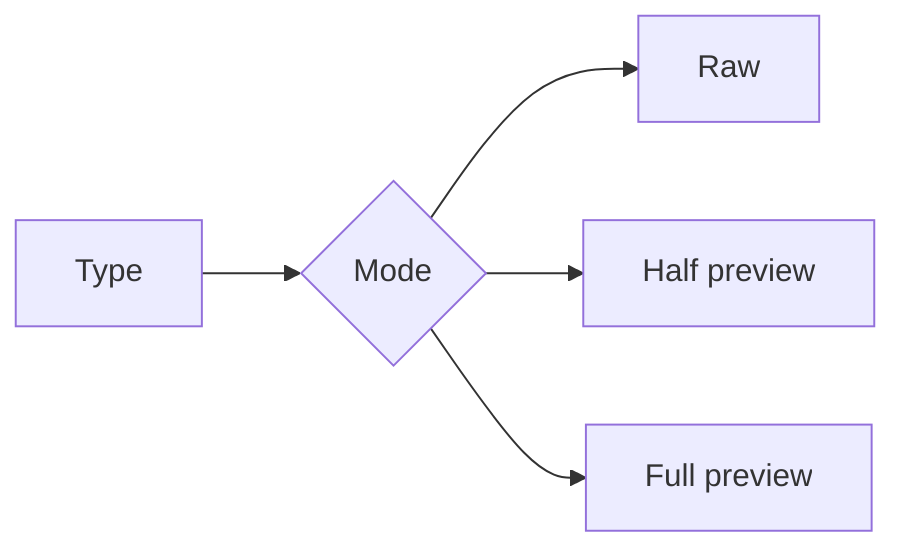

# Preview

A scratch document for trying the editor. Edit it freely; `git checkout sample/preview.md` puts it back.

## Text

Paragraphs with **bold**, *italic*, ~~strikethrough~~, `inline code`, a [link](https://example.com) and a footnote.[^1]

> [!TIP]
> Toggle the outline with `Alt+O`, switch modes with `Alt+M`, and find with `Cmd+F`.

> [!WARNING]
> Undo right after typing should undo that typing.

## Lists

- [x] Done
- [ ] Not done
  - Nested item

1. One
2. Two

## Table

| Name  | Status | Owner |
| :---- | :----: | ----: |
| Alpha | Ready  |   Ana |
| Beta  | Draft  |   Leo |

## Code

```js
function greet(name) {
  return `Hello, ${name}!`;
}
```

## Math

Inline $e^{i\pi} + 1 = 0$ and a block:

$$
\int_0^\infty e^{-x^2}\,dx = \frac{\sqrt{\pi}}{2}
$$

## Diagram



## Image


[^1]: Footnotes jump back and forth with Cmd/Ctrl+click.
